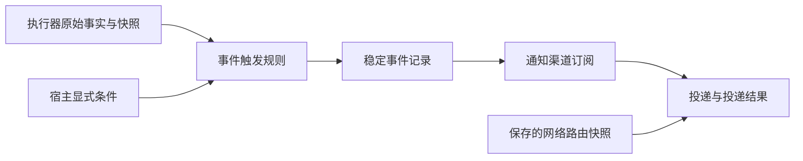

# 事件与通知独立模块合同

版本：1.0，2026-11-15。范围为已授权的产品设计与可丢弃内存原型，不代表 Android、模型、任务源、代理或通知服务已接通。

## 所有权与数据流

[execution-simulator.js](../prototype/execution-simulator.js) 独占执行调度、输入所有权、运行游标和原始业务事实；[event-rules-simulator.js](../prototype/event-rules-simulator.js) 独占规则配置、持续条件 episode 与派生事件。渠道订阅和投递由通知模块/原型宿主消费事件，不进入调度器。界面入口与排版以 [app-v2.html](../prototype/app-v2.html) 及 [UI 设计](ui-design.md) 为准。

执行器只提供 logicalTimeMs 等逻辑时间事实，以及 run_started、task_started、task_finished、run_finished；已不拥有 waitNotification 配置或等待提醒的开关/阈值。advanceTime 是原型逻辑时间注入入口，advanceWait 为兼容别名，不是真实计时器。旧 [执行模拟器合同](execution-simulator-contract.md) 中若仍有“等待通知”所有权描述，以本文件及实际模块为准。

事件生成不依赖是否配置渠道。没有订阅也保留事件；订阅决定向哪些渠道投递，投递结果不反向改变事件是否发生。发送失败不能暂停、取消、重试、提权或放行游戏任务，也不能把 unknown 改成 failed。通知读取/已读不等于异常已解决；业务核对仍由执行器及宿主明确完成。

## 首批 11 项规则

所有规则初始 `enabled:false`。catalog 的建议值是本项目提案，只用于编辑/显示，不是上游项目默认，也不会自动启用。duration/count 的有效阈值初始 null，启用必须显式保存阈值；不额外设重复提醒、静默、自动停止或重试策略。

| 稳定 ruleId | 名称 | kind | 建议值或结果选择 | 原始依据 |
| --- | --- | --- | --- | --- |
| execution-failed | 连续执行失败 | count | 1 轮 | run_finished 为 failed/partial_failed，按 ref.kind + ref.id 统计连续轮数 |
| unknown-result | 结果待核对 | instant | 无阈值 | runs[].unresolved，包含已取消但仍有未知结果的 run |
| queue-wait | 排队等待过久 | duration | 10 分钟 | queued 且首次 dispatch 尚未发生 |
| no-progress | 执行无进展 | duration | 5 分钟 | 当前 run + executorGeneration + cursor.completedSteps，无进展持续时间 |
| condition-lost | 运行条件中断 | instant | 无阈值 | 宿主显式条件 |
| resource-shortage | 资源或容量受限 | duration | 10 分钟 | 宿主显式条件 |
| vision-unavailable | 视觉服务异常 | duration | 2 分钟 | 宿主显式条件 |
| task-started | 任务开始 | instant | 无阈值 | task_started，包括独立任务及计划成员 |
| task-succeeded | 任务成功 | instant | 无阈值 | task_finished 且 result=completed |
| plan-started | 计划开始 | instant | 无阈值 | ref.kind=plan 的 run_started |
| plan-completed | 计划结束 | result | 初始选择 completed/partial_failed/failed/cancelled，可筛选 | ref.kind=plan 的 run_finished |

execution-failed 对整次执行项计一轮：一个 partial_failed 计划只加一轮，不按失败成员数叠加；completed 清该实体连续失败计数。unknown、cancelled 不计确定失败，也不冒充成功清计数。task 与 plan 即使 id 相同也分别统计。计划结束与任务成功分开订阅，独立 task 的 run_finished 不再生成第二条 task-succeeded。

run_started 只在首次真正 dispatch 产生一次；task_started 在该成员首次得到执行权、旧输入已静默且准备开始时产生一次。恢复和 run_dispatched 不重新生成开始事件；手动 hold 期间结算前一个成员不会提前宣布下一成员开始。此业务事实来源属于执行器，规则层不从 cursor 猜测开始。

## 规则模块 API 与快照

UMD 全局为 `window.YysEventRulesSimulator`，Node 可 require；导出只读 catalog 与 create()。新实例不共享内存状态。

| API | 合同 |
| --- | --- |
| configure({commandId,ruleId,enabled,thresholdMs?,thresholdCount?,results?}) | 更新一条规则。duration 采用显式非负毫秒，count 为显式正整数；结果选项限计划的四种终态。建议值不会自动成为配置。 |
| observe(executionSnapshot) | 只读执行快照，消费 logicalTimeMs、raw events/runs/active/scheduler；相同 raw 事件稳定去重，不推进调度器。逻辑时间倒退或无效返回 invalid_clock。 |
| setCondition({commandId,ruleId,sourceKey,active,reason?,name?}) | 仅接受 condition-lost/resource-shortage/vision-unavailable；sourceKey 区分条件来源，active=false 结束该 episode。 |
| getSnapshot() | 返回 JSON 副本 `{rules,events,clockMs,revision}`；没有订阅、渠道凭据或投递状态。 |

每个事件为 `{id,type:ruleId,ruleId,name,runId?,sourceKey,atMs,detail}`。detail 包含 episodeId；持续时长/连续次数规则补相应值及有效阈值，任务生命周期补 taskId/taskIndex，计划结束补 result。id 稳定，供消费者建立投递归因；raw 事件复读不重复计数。原始 run_finished 暂时缺少对应 run/ref 时保留待归因机会，不把缺证据当作事件不存在。

configure 与 setCondition 需要 commandId：同 ID 同内容返回原结果，同 ID 不同内容拒绝。事件模块没有 onChange；宿主在 configure/observe/setCondition 后读取快照，再由通知模块处理新增事件。

## 持续条件、时间冻结与离散事实

持续条件按 ruleId + sourceKey 保持 episode，单 episode 最多产一条事件。关闭再开启规则、修改阈值均不重复发送已经产出的同 episode 事件；条件真正恢复后再次出现才建立新 episode。持续中的 unknown、wait、condition、failure streak 可以在用户启用/调整规则后按当前状态评估。

queue-wait 仅衡量入队至首次 dispatch，已执行后自动挂起的恢复等待不纳入这一范围，移除后不继续产生等待事件。manual_hold/reconciling 时不累计等待或执行无进展。preempted 不作为当前执行项累计 no-progress。原型按相邻快照逻辑时间与计时资格累计，不使用真实时钟；冻结边界缺少精确瞬间时采用保守计时，不推测后台实际执行时长。

no-progress 以 runId、executorGeneration、cursor.completedSteps 建立观察身份，不能以像素静止推断卡死。宿主可在 active.expectedWait 或 snapshot.expectedWait 标记 `true`，表示合法战斗/等待，此时不累计无进展。该标记真实性仍依赖未来真实执行器，不是本原型已识别游戏状态的证据。

四类正常生命周期是离散事实：task-started、task-succeeded、plan-started、plan-completed 只在首次消费对应 raw fact 时按当时规则评估，随后移出持续 episode 容器，但保留 seenRaw。规则关闭期间已经观察过的历史事实，之后开启或改筛选不补发；新事实仍正常触发。不能通过删除 seenRaw 回放旧事实。

## 通知管理、历史与渠道

原“排队等待通知”入口改为“通知管理”，内含 channels、event-rules、event-log 三个部分。规则入口管理“何时产生事件”，渠道入口管理“订阅哪些事件、如何投递”，事件记录展示事件事实及关联投递结果。

历史记录只保留“通知”和“运行”两个 tab，横屏使用左侧 tab；不再把规则编辑页当作第三种历史。通知记录与运行记录以 eventId/runId 关联，不通过删除历史解除业务安全阻塞。

渠道订阅使用稳定 ruleId，不以中文 label 或任务名作为协议标识。未来投递记录需能关联 eventId、channelId、订阅及路由快照版本，并独立显示投递结果；保存渠道不等于真实推送测试成功。当前事件模块没有真实发送能力，不在此新增服务商、重试次数、重复提醒或订阅默认。

## 网络路由设计边界

网络设置支持 HTTP/SOCKS5 类型；用户多选作用范围：模型、任务源、外部通知。实际请求使用发起时已保存的 route 快照，不能读取正在编辑的草稿，也不能在请求途中被后续设置修改悄悄切换。

三个请求域分别持有自己请求的路由引用及结果；外部通知网络失败属于投递失败，不能成为调度控制信号。模型请求失败、任务源获取失败仍保留各自原有错误含义，不能因代理失败解释成模型不存在或任务下架。此处不新增自动直连回退、代理探测、自动重发或凭据输出策略。

这些是已确认设计要求。原型没有建立 HTTP/SOCKS5 连接，也未证明 Android、模拟器、模型供应商或任何通知服务的网络兼容性；route 快照的真实传输适配尚待实现。

## 验证证据与剩余边界

[规则测试](../prototype/tests/event-rules-simulator.test.cjs) 从 16 情境扩为 18：新增“关闭时消费生命周期事实，开启不回放，启用后新事实仍触发”及“持续条件启用仍可评估”。回放反例修前实际失败（开启后产生 4 条旧事件，期望 0），修后通过。当前 18/18，通过真实内存执行器 onChange → observe 集成验证任务/计划事实、hold 后成员开始、恢复不重复、成功归因和订阅分离；另含等待阈值/冻结/移除、unknown 取消后保留、连续失败、条件恢复、无渠道仍产事件、输入快照只读和 UMD 加载。

根 agent 报告 [执行器测试](../prototype/tests/execution-simulator.test.cjs) 当前 31/31；这是独立调度器模拟测试结果。界面仍在集成，本文不把源代码测试写成浏览器全流程验收。

事件模块 checkpoint SHA-256：`a9b86b5807f3272d3376c414993248b9f89e1dda2ead711501a5e0c0f246e176`。所有规则、raw 去重、episode 和记录只驻内存，没有进程恢复、持久投递去重、真实时间、真实条件识别、网络连接或通知发送。内存测试不证明全天运行可靠性、Android 输入静默或服务可用性。
