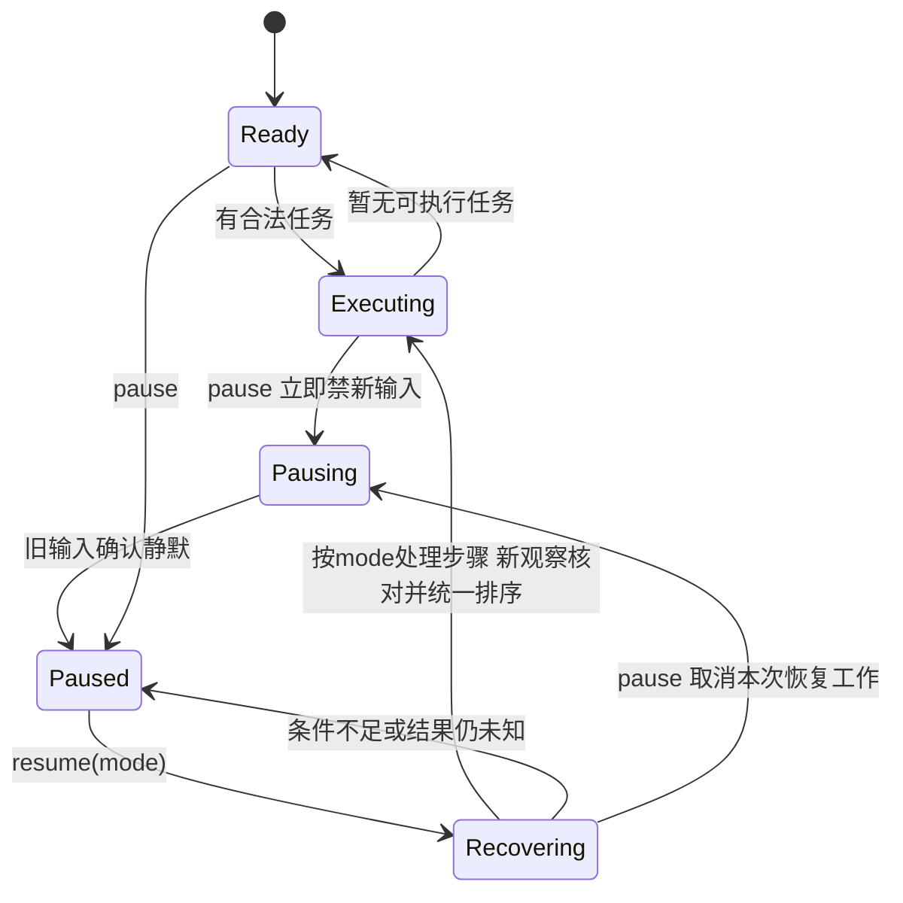

# 系统架构评审稿

版本：1.0-draft；日期：2026-11-15。**状态：已完成本轮职责与调用链复核，待产品与技术评审；尚未实施。**

本稿按用户最新解释整体重写。产品依据为[PRD v2.4](../PRD.md)与[领域用语](../../CONTEXT.md)；界面依据为已获用户认可的[UI v5](ui-v5/index.html)；[App v2 交接](app-v2-design.md)仅在不冲突处保留作交互来源。**已确认**是产品规则，**推荐**是待评审实现选择，**待定**是尚需验证或决定的部分。本轮只改设计，不改JS原型、开发、发布或操作真实账号。

技术选择、候选比较与可行性结论统一见[技术方案1.0](technical-plan.md)；其依据包括[F01–F21需求矩阵](../research/requirements-feasibility-matrix.md)、[Android平台核验](../research/android-platform-feasibility.md)和[开源运行时源码比较](../research/native-runtime-feasibility.md)。结构合理、上游接口存在与本项目实测通过是三个不同结论。

**2026-11-16 实施补记：**用户已确认原生栈与首期 M0–M4，工程开始实现，实际进度见[实现记录](../development/implementation-status.md)，不再以本稿最初的“尚未实施”概括当前工程。用户同时要求后续可扩展到其他游戏及普通 App：通用动作、执行器和设备桥不绑定阴阳师业务；目标内容声明包名、分类与身份策略；任务、配置、计划及历史按 `targetId` 隔离。执行上下文由目标＋已核对身份组成，无需账号用明确匿名身份，未知身份不放行。首期仍验证阴阳师，多应用切换及跨应用编排另定，具体合同见[扩展边界](../development/target-extensibility.md)。

## 1. 动作、步骤、任务与计划

| 对象 | 定义 | 不承担的事 |
| --- | --- | --- |
| Action | App提供的可复用基础能力，输入输出明确，如观察、定位、点击、滑动与核对 | 不拥有独立队列或暂停／恢复状态机 |
| Step | 为完成一个业务阶段组织动作编排 | 不保存动作调用栈来实现中途续跑 |
| Task | 一项具体业务的多个步骤＋一组配置schema，如领取物资、悬赏封印、结界放卡 | 不拥有独立暂停／恢复／重启状态机 |
| Plan | 有序任务集合＋执行时间＋所属账号 | 不拥有另一套执行器或暂停／恢复状态 |
| Executor | 唯一任务执行器，管理队列、当前任务、步骤进度、暂停和恢复方式 | 不把游戏流程、识别引擎和通知供应商实现写在调度逻辑里 |

内容层次为动作→步骤→任务→计划；Executor是执行这些内容的运行者，不是另一层任务定义。任务是配置和交付的基本单位，配置schema与用户保存值分开；步骤和动作引用同一份任务配置。具体表达提案与示例见[动作与步骤模型](action-step-task-model.md)。

**暂停听执行器的。继续和重新开始不是两套控制对象，只是执行器恢复时的两种方式。**

最小调用链：

```text
任务列表／计划列表／悬浮常用 → Executor.enqueue(tasks, source, order, priority, account)
定时计划到点               → Executor.enqueue(该计划的任务集合及来源)
工作台／列表／悬浮控制     → Executor.pause()
用户选择继续               → Executor.resume(mode = continue)
用户选择重新开始           → Executor.resume(mode = restart_current_task)
Executor                   → TaskWorker解释当前步骤的动作编排
TaskWorker                 → 调用容器注册的动作能力
TaskWorker                 → 返回步骤结果／新观察／待核对原因
```

计划行的“当前／队列中”与暂停按钮由执行器快照投影；点暂停最终仍调用同一个Executor.pause()，不是PausePlan。任务本次执行仅保存进度与结果数据，不另造TaskRun或PlanRun的控制生命周期。

## 2. 执行器怎么运行

**已确认：**所有手动提交和定时提交都入同一队列，不直接并发操作游戏。计划按成员顺序做，整份计划本次排序分值是全部成员优先级之和，期间不递减。计划30当前成员10时，独立任务25等待。

排序先过滤当前账号、能力和恢复条件不满足的项，再按严格高优／同分FIFO选择。其他账号的高优受阻项不能抢占当前账号合法任务。更高优项在旧输入静默和结果安全条件具备后接手；恢复原任务仍跳过完成步骤。

### 暂停与两种恢复方式

- `pause()`：立即禁止全队提交新输入；旧输入尚未静默时显示暂停中，独立确认静默后才显示已暂停，供用户自己操作游戏。
- `resume(continue)`：已完成步骤跳过，当前未完成步骤从入口重新观察后执行；不能整任务重头。
- `resume(restart_current_task)`：当前任务从step1重做，其他任务进度不变。计划里已经做完的任务自然保留；本次集合不重新入队，不改变合计优先级。
- 两种方式都沿用本轮任务包和已保存规则，不借恢复切版本、换配置或重置累计消费上限。重新开始是明确人工选择，不是失败后自动重试。

暂停后不保留可直接续跑的TaskWorker调用现场；恢复时重新调用选定步骤的入口。旧工作器结果不能推进新的步骤尝试，已发动作的结果仍按原actionId保留核对。本次任务提交身份保持不变，恢复按钮本身不是一次新的任务开始事实。

例如计划的领取任务完成，当前兑换任务中途暂停：继续会跳过已完成的领取任务及兑换任务已完成步骤，从未完成步骤重新观察；重新开始只把当前兑换任务回到step1。旧尝试的结果与真实消费仍保留。

只有一张执行器状态图：



图只描述执行器控制；2026-11-16 用户已确认 App 重开后自动恢复可确认安全的任务，未知暂停核对，开机和定时补做边界仍分别处理。任务进度、平台输入是否静默和业务结果各记事实，不再给任务／计划画暂停图。自动抢占是在执行器内部换当前任务，不是再创建一层暂停状态机。

既有停止／移除范围与差异不因本稿改变：停止保留全队暂停，移除不新增或解除已有人工暂停；当前项移除须旧输入静默且结果安全后才继续后续项。任务已取消也可能有未知业务结果，不能删行清证据。

**已确认的恢复语义：**继续与重新开始均是唯一执行器的恢复动作；UI v5 已提供两种选择。`resume(mode)` 是落实该语义的接口建议，由同一执行器处理已有人工暂停和统一排序；不能让某页自行解除暂停或宣称当前任务立即抢到执行权。当前 HTML 展示不证明生产恢复接口已实现。

## 3. 实现分工与运行位置

**推荐：**Android原生模块化应用，Kotlin编写执行器与平台适配，Compose实现原生界面；同一产品APK在手机和Windows安卓模拟器分别验证。Compose只负责呈现，不负责运行或保活。[官方原生UI说明，2026-11-15核验](https://developer.android.com/compose)

| 模块 | 负责什么 | 关键限制 |
| --- | --- | --- |
| UI／悬浮球 | 草稿、布局、发命令、展示执行器快照 | 不维护第二队列，旋转不重建执行器 |
| 任务制作器 | 开发者模式中的动作／步骤编排、配置schema、JSON生成校验及调试展示 | 调试复用Executor，不直接输入；不要求作者手写完整JSON |
| Executor | 队列、当前任务、步骤进度、pause/resume(mode)、结果确认 | 处理命令时不等OCR／网络完成 |
| TaskWorker | 解释已锁版本的步骤及动作编排，绑定任务配置与动作输出，返回步骤结果 | 不直接持有输入权，不自己重启调度 |
| DeviceBridge | 实际截图／输入／静默回执和能力事件 | 薄控制路径，不跑任务脚本、OCR或网络 |
| 任务版本管理 | 拉取、验证、单版本启用、引用及删除 | 不自动运行或修改用户规则 |
| GitHub授权与发布适配 | 授权登录、查询指定仓库权限、上传JSON／资源并发布Release，以及版本拉取 | 不自建账号／白名单／发布后端；用户实际权限与令牌授权均须满足，令牌不进入任务JSON |
| 游戏与账号 | 启停／登录态操作、身份核对和快照资料 | 操作前调用同一执行器暂停，不建账号专用调度器 |
| 事件规则／通知 | 规则产事件；渠道订阅并记录投递 | 失败不回滚业务结果、不控制执行器 |
| 本地存储／网络／秘密 | 持久化、路由和凭据适配 | 不代替业务决策，不向UI或任务包暴露秘密 |

主进程承载上述业务模块；**推荐把薄DeviceBridge放独立进程**，使TaskWorker卡死时仍能接受撤销。它不是第二执行器，也不写业务库。Android允许Service指定进程，具体无障碍／投屏／Root部署需设备验证；单进程替代的限制见[决策记录](architecture-decisions.md)。[Service官方机制，2026-11-15核验](https://developer.android.com/guide/topics/manifest/service-element)

截图和输入先比较标准Android能力；Root仅用于用户接受的专用启停／登录态路线，不暗中成为所有任务前提。平台回执只说明输入情况，不证明游戏领取／兑换已成功。

## 4. 最少需要保存的数据

**推荐：**一个Room／SQLite本地状态库；图片、任务资源和快照密文存私有文件，库里存引用。各模块通过统一存储提交自己的状态，不把通知实现塞回执行器。[Room官方说明，2026-11-15核验](https://developer.android.com/training/data-storage/room)

| 数据 | 必要内容 |
| --- | --- |
| Task／配置 | taskId、配置schema、已保存配置版本、优先级；步骤的稳定stepId、动作编排及完成依据 |
| Plan | planId、所属账号、有序taskId、每日／指定星期与时间、已确认的时长配置 |
| 执行器进度 | 当前任务、成员／步骤位置、已完成结果、全队暂停事实、未决动作引用 |
| 队列提交记录 | 来源ref、账号、成员顺序、入队序号、固定排序分值、绑定任务包／配置版本；这是内部排序与去重元数据，没有暂停状态 |
| 必要动作记录 | actionId、输入代际、观察依据、已生效／未生效／未知结果及最小尝试身份；不是动作中途恢复快照 |
| 账号／登录态操作 | 已核对身份、待启动目标、加密快照引用、兼容／验证状态和恢复阶段日志 |
| 任务版本 | 目录、单个启用版本、资源digest、安装／删除阶段及使用引用 |
| 事件与投递 | 原始事实、规则消费位置／episode、派生事件、渠道订阅／路由版本和投递结果 |

同一顶层ref(kind,id)只允许一个未结束提交，排队／挂起也占用；计划成员实例不能和计划引用混用。commandId／occurrenceId重投返回原处理结果，不用新runId绕过去重。

提交步骤结果时，同时保存完成进度和原始事实。后续事件规则与投递各用独立事务：失败不回滚结果，不持有业务输入门；若新的业务动作意图本身不能写入，则是执行安全存储故障，不能继续消费型动作。

不保存动作中途游标、工作器上下文、多层checkpoint或资源预留快照。不建通用事件溯源平台；数据库事务也不能使游戏服务器、手势和文件具有事务性。

## 5. 输入安全与结果未知

**已确认：**确认失败记录后继续后续任务，部分失败如实汇总；unknown不等于失败，不能自动重做兑换或强化。

**推荐：**执行器给输入桥的命令带任务、actionId、当前会话／代际与画面几何。输入桥串行处理提交和撤销；暂停、切号或移除后的旧工作器／模型回执不能再次点击。移除卡死任务由桥独立确认静默，不等旧任务回调。

可能已生效但未知时，先新观察核对：已生效记录结果，确认未生效才允许重做，仍无法确认则继续等待。resume的重新观察、restart的step1、进程重启都不能绕过这条规则。桥断联、kill或timeout也不能证明平台旧手势已结束；整个App被系统停止更不保证可控制。

这是步骤模型所需的安全事实，不是复杂断点系统。

## 6. 云任务版本与识别

**已确认：**壳＋云任务版本；一次App启动自动拉latest，也可手动拉，旋转／切页不重复触发，拉取不启用。只有一个启用版本，右上显示版本与必要红点；本地版本可展开更新说明／启用／删除，当前项禁用。存在未结束提交或unresolved时不切版本。

动作由App实现与更新；开发者基于这些动作编排步骤和任务、编写配置schema，封装一套JSON与资源发布为云端任务版本。用户拉取后配置并提交任务，或组合定时计划。任务不是每次随APK硬编码发布，计划也不要求开发者逐用户编写。JSON方向已确认，具体字段与动作接口协议仍待设计。

制作和调试在受保护的App开发者模式内完成，JSON由编辑内容生成；采用GitHub授权及指定任务仓库权限保护入口，开发者明确上传成功即发布该仓库Release。调试复用唯一Executor，草稿保存／试跑不自动上传，也不混跑托管输入。GitHub承接发布鉴权及Release附件分发，替代此前自建发布接口提案；客户端须完成完整附件与发布的协调。授权流程与上传内部步骤建议见[任务制作设计](developer-task-authoring.md)。

**推荐：**一个不可变任务集包含目录、步骤流程、参数schema和资源，内部digest可复用，不提供每task版本混搭。TaskWorker解释受限数据和内置原语，不下载执行任意JS／DEX／native代码；原语不足才升级壳。[动态加载风险，2026-11-15核验](https://developer.android.com/privacy-and-security/risks/dynamic-code-loading)

下载到暂存，校验来源／内容／schema／能力后登记完整版本；DB与文件用阶段日志协调，半套资源不供执行。启用、入队绑定和删除统一核对引用，防检查后占用竞态。当前、在途及未决恢复引用不能删，已完成历史摘要不永久锁包。删除／回退不删规则、计划或消费证据。包放持久私有文件，不仅放可回收cache。[私有文件说明，2026-11-15核验](https://developer.android.com/training/data-storage/app-specific)

参数schema保留类型、单位、精度、空值与控件语义；滑块和精确值共享一个值，不编预算上限；时间／日期用相应控件。未知必需字段或原语不兼容，不能忽略后执行。来源信任、签名／撤回和技术限额待定，无自动激活／回退或额外轮询。

本地观察综合文字／数字、图标、相对布局和步骤上下文，主题素材不与业务脚本绑定。画面携带捕获时间、窗口／账号／环境、方向和裁剪缩放映射；旋转使旧坐标失效，关键余额空值不当零。当前技术方案以PaddleOCR／ONNX＋OpenCV作为直接集成比较基线，另验Maa纯识别与ML Kit中文bundled；最终后端依据同一留出主题、ABI、性能和网络路径验证确定。候选与选择依据见技术方案，公开能力不证明游戏表现。

云模型只在用户开启并配置后提供当前步骤的受限提案；执行器核对目标、资源和新鲜度后才发输入，模型不改预算／计划／账号。请求绑定连接、凭据、路由与任务代际；失败不跨服务fallback，取消后晚到不点击。新活动须披露人工帮助和专用修补，不以读取规则成功冒充全流程自主完成。

## 7. 账号、日程与通知

游戏启停／切号前调用同一Executor.pause()，等待静默及目标停止证据，再做兼容／后备检查和分阶段登录态操作。启动后新观察核对UID／区服／渠道；实际核对成功且账号改变才清旧未结束队列。失败／回退保旧队列，所有路径仍等用户明确恢复。

待启动账号不等于实际身份。快照加密且保存成功仍未验证；停止前不能选别号，有unknown不能跨号，删除快照不删计划／历史。原计划保原号，当前账号摘要读取已核对账号；普通任务参数是否另行按号保存不从计划隔离自动推导。Root同环境往返、升级、失效和回退均待[实机验证](game-lifecycle-account-boundaries.md)，不承诺普通权限、免登录或跨设备。

计划保存即登记日程，无周期总开关；到点只提交任务集合，不解除暂停、自动切号或借新账号执行。稳定Occurrence防重投重复，前轮仍live不再提交一份。时区、错过／重叠、最长时长到限和实际唤醒策略待定，不私设补做或自动停止。开机自启只恢复助手检查路径，不自动游戏或resume；FGS／投屏仍受系统约束。[FGS限制](https://developer.android.com/develop/background-work/services/fgs/restrictions-bg-start)、[投屏限制](https://developer.android.com/media/grow/media-projection)

11项事件规则默认全关，任务开始／成功来自任务事实，计划开始／结束从本次任务集合事实派生，无需计划状态机。规则关闭时消费离散事实，后开不回放；持续条件一次episode一次，人工暂停／恢复核对冻结相关等待计时，正常战斗不算无进展。没有订阅仍有事件。渠道接收≠用户已读，发送中断保留投递unknown，不凭待发送记录自动重发。细则见[规则合同](event-notification-architecture.md)，其中旧原型接口不能覆盖本稿模型。

代理按model／task-source／notifications选择，默认直连，外部通知包含SMTP，本机通知不联网。HTTP／SOCKS5认证、DNS、TLS和SMTP分别验证，HTTP成功不能代表邮件代理；选中域失败不静默直连，在途请求沿用原route。凭据按连接归属隔离，DB只存秘密引用，推荐Keystore保护密文；不进日志／导出／任务包。[Keystore官方说明，2026-11-15核验](https://developer.android.com/privacy-and-security/keystore)

## 8. 崩溃与24小时目标

恢复只读取已完成步骤、必要动作结果和未完成操作日志；先关输入门换新桥会话，unknown先核对，再按明确恢复意图处理当前步骤。命令已接受但界面超时不能换ID再提交；业务结果已记但通知未更新只补投影，不重做游戏动作。包／登录态多文件提交按阶段与后备检查，不能把逐文件复制包装成原子事务。迁移失败不清库换启动，APK回退不等于DB可降级。

截图、OCR、模型、下载和投递均有有界在途工作／背压；过期帧可丢但动作证据不可偷换。Bitmap／Image／native资源、推理和投屏在完成／取消／异常路径释放；旋转不重建执行器。日志截图按留存和引用清理，不逐帧无限落盘；容量不足不得继续无法记录的消费动作。生产限额与性能门槛经压力实验定，不编频率／容量／超时默认。

系统能停止整个前台服务App且不保证退出回调，不能等退出才存状态，进程已死也不能自己保证死亡告警。外部监控未在范围内。[系统停止行为，2026-11-15核验](https://developer.android.com/develop/background-work/services/fgs/handle-user-stopping)

## 9. 工程建议与证据边界

建议初始`:app`负责原生呈现与装配，`:core`负责Executor／步骤／队列与规则合同，`:data`负责持久化／网络／秘密，`:device`负责Android能力与薄桥。识别和渠道先作适配包，有真实依赖／ABI需要才再拆工程；UI、TaskWorker、通知不能绕执行器直接输入。

待重审的推荐选择、替代和验证门槛分别见[决策记录](architecture-decisions.md)及[验证路线](architecture-validation-plan.md)。设备／分发、任务源信任、日程缺口、自主活动／费用／外发范围仍待明确，不把未知项默认成自动化。

旧稿的TaskRun／PlanRun暂停状态机、动作中途checkpoint和每task版本混搭均不再作为本方案。旧[调度稿](execution-scheduler.md)、[容器稿](task-container-architecture.md)与[事件稿](event-notification-architecture.md)只在不冲突处作细节参考。此前72内存情境／512浏览器检查记录在[旧基线](verification-settings.json)；本轮未重跑，且它们不证明本次Executor.pause/resume(mode)模型已实现。旧JS原型须后续对齐。

本轮已复核职责、三条控制调用链及其与优先级／账号／通知规则的一致性；技术选择仍是待评审提案。没有Android工程、真实输入／账号／模型／通知／代理或24小时验证，文档复核不等于实现验证或获准实施。

### 2026-11-16 实施补记

App 重新打开的恢复策略已获用户确认：可确认安全的任务自动恢复，未知保持阻塞核对，既有人工暂停仍保留。当前实现进度与实测见 development 文档；本架构的框架研究状态不替代工程／平台证据。
