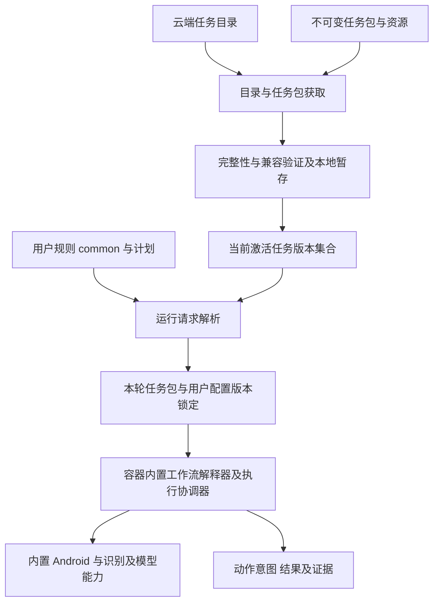

# Android 任务容器与云端任务包架构

版本：0.3 
日期：2026-11-15 
状态：系统设计提案，未实现、未发布、未部署云服务。

阅读说明：本文件保留较早的包协议候选。当前整体设计见[系统架构 1.0](system-architecture.md)，产品行为以 PRD v2.4 为准。下文 ActivationSet／按 task 映射版本的组织方式不作为已确认能力；当前采用单个启用任务集版本，包内依赖摘要不构成用户混搭版本的入口。

最新内容模型采用动作→步骤→任务（步骤＋配置schema）→计划；下文“原语”对应容器提供的动作能力，具体步骤表达以[动作与步骤模型](action-step-task-model.md)为当前提案，不由旧检查点描述增加动作中途恢复。

## 一 已确认方向与设计结论

用户明确要求 App 是任务管理和执行的容器，游戏任务从云端获取；日常游戏更新不应每次升级 App。容器负责平台能力、解释执行、状态与用户规则，游戏相关任务定义、流程、识别资源及规则表单通过版本化任务包独立维护。

本稿细化这一方向，与[系统架构](system-architecture.md)共同使用。已确认启动 App 自动拉取最新版、手动拉取、逐版本更新说明、本地历史删除和用户指定使用版本。声明式工作流、包验证及激活机制为待评审的实现建议；GitHub 授权、指定仓库权限、Releases 分发及明确上传即发布已经确认；实际仓库与客户端、持续后台轮询、自动激活／回退、任意脚本支持及具体发布协议尚未冻结。当前仅进行设计与内存原型，不实现真实云服务。

正常更新应尽量只更新任务包。只有任务需要容器尚不存在的执行原语、识别引擎能力、规则语义、平台支持或安全修复时，才需要升级容器；不能承诺所有未来玩法永远不升级 App。

## 二 容器与云端的职责

云端在此负责分发任务目录、不可变任务版本和配套资源，不是远程控制游戏的执行调度器。拉取任务不需要由此推导商业账号、订阅、支付、远程指令、云端截图托管或设备管理平台。

| 容器内置且随 App 演进 | 随云端任务包独立演进 |
| --- | --- |
| Android 授权、捕获、输入和生命周期 Adapter | 游戏任务目录、名称、分类与说明 |
| 工作流解释器、允许的执行原语与规则求值器 | 任务工作流、语义页面与正常导航关系 |
| 动作校验、执行串行化、检查点与结果核对基础设施 | 具体前置条件、后置条件与游戏结果核对步骤 |
| 本地识别引擎、可选模型接入及凭据保护 | 图像模板、OCR 目标区域、布局锚点、已支持格式的模型／词典资源 |
| 计划、common、配置版本、资源保留和运行记录 | 参数 schema、表单元数据、任务可声明的资源影响与规则约束 |
| 通知 Adapter、悬浮球与公共页面组件 | 任务适用环境与主题声明、依赖和发布验证说明 |
| 来源信任、任务包验证、版本激活及回滚基础设施 | 版本清单、兼容条件及纯数据的字段迁移说明 |

任务包不能修改 Android Manifest、启动新的平台权限、安装新 Service 或向容器注入新的任意系统调用。下载一个任务不等于自动启用、执行或加入计划。

## 三 任务包内容与受限工作流

### 3.1 包内容

建议一个任务包可包含一个或一组有共同版本关系的任务。每个任务仍有独立稳定 taskId，包的组织方式不能改变用户理解的任务身份。

- 任务定义：taskId、业务类别、说明、入口、目标、能力要求和资源影响类别。
- 工作流：稳定 stepId、状态转换、观察、条件、正常导航、候选动作、等待、检查点和结果核对。
- 识别资源：图像、文本模式、布局与锚点、容器已支持格式的推理资源，以及资源间引用。
- 参数与规则 schema：稳定 fieldId、类型、单位、约束、用户可配置项及与资源消耗的关系。
- UI 元数据：容器能够呈现的标签、说明、字段分组和帮助，不包含任意可执行 HTML／JavaScript 页面。
- 兼容信息和验证说明：游戏环境及版本范围、主题覆盖、依赖、发布测试来源和已知限制。

### 3.2 工作流能力

建议采用由容器解释的受限声明式工作流，而不是把任意脚本语言作为任务包默认格式。可表达条件分支、受限循环、导航、观察和动作核对；游戏流程更新可以在相同原语集合内完成。

工作流的节点只能调用容器注册、已验证的原语，例如请求观察、定位语义目标、提出点击／滑动、等待条件、核对结果和结束任务。名称只是契约示意，不是当前已实现接口。

解释器校验节点和资源引用、条件类型、循环和等待的退出路径、检查点以及错误分支。内存、文件数量、资源大小、推理和循环预算受容器限制，不能由包单方面解除；具体技术限额待实验确定。

通用流程可以声明“需要兑换某商品”，但实际商品、数量、预算与允许消费仍取自用户规则。远端 schema 的新默认值不能成为自动扩大消费、解锁御魂或新增外发权限的途径。

如现有原语无法表达新玩法，应明确返回缺少能力或需要升级容器，先提出原语扩展方案。不得以临时 eval、远程 DEX、shell、任意 JS 或下载本地库作为兼容降级；是否另行支持脚本需要单独设计和批准。

### 3.3 数值与时间日期控件

用户要求数值、时间和日期按场景使用滑块或选择器。建议参数 schema 同时表达值语义与 `widget` 提示，容器以现有安全控件呈现；具体 schema 字段及控件协议仍是实现提案，不下载任意 UI 代码。

| widget 语义 | 值与约束 | 控件选择原则 |
| --- | --- | --- |
| number | 整数或明确精度的数值、单位、步长及有依据的上下限 | 精确计数使用步进或数值选择器；不能把字段全当普通文本 |
| range | 数值及明确有效范围、步长和单位 | 适合范围内调节时使用滑块并显示当前数值；不得为使用滑块随意制造预算最大值 |
| time | 时分或所需精度、时间所属时区／本地墙钟语义 | 使用时间选择器；说明是游戏时区、设备本地时间还是指定时区，不能静默互换 |
| date | 日历日期、适用时区和允许日期范围 | 使用日期选择器，不将日期值隐式解释成某个 UTC 时间戳 |
| date-range | 起止日期、端点是否包含、适用时区及起止顺序约束 | 使用日期范围选择器；仅服务现有任务字段，不由控件推导新的调度行为 |

字段约束来自任务定义和已确认规则。资源动态上限若依赖观察，需携带依据与有效条件；没有可靠最大值时使用能够精确设置的安全数值控件，不能硬造数值、悄悄截断原预算或扩大用户限制。单位与时间语义变化按 schema 迁移处理，保存后不自动执行。

任务包声明所需 widget 类型与协议版本，容器 capability 清单提供可用安全控件。未知 widget 或无法保持值语义的控件要求应报告不兼容；只有任务明确提供且语义等价的容器内置替代控件才可回退，不能执行远端渲染代码。

## 四 目录 Manifest 与兼容契约

以下为需评审的语义字段，不是已冻结网络协议或数据库 schema。

| 契约 | 关键字段与意义 |
| --- | --- |
| TaskCatalogEntry | 稳定 taskId／packageId、可选版本、发布身份、说明、分类、目录修订及对应 manifest 位置／摘要 |
| TaskPackageManifest | packageId、不可变 packageVersion、manifestVersion、workflowSchemaVersion、parameterSchemaVersion、内容 digest、签名与信任标识、依赖列表、发布验证说明 |
| 版本与能力要求 | 最低／兼容容器版本、必需 capability 及其协议版本、可选 capability、支持的资源格式与引擎、widget 类型与协议版本、必要 Android／ABI 条件 |
| 资源清单 | 每个工作流和资源的相对路径、类型、大小和 digest；依赖使用不可变版本或摘要 |
| ActivationSet | taskId 到已激活任务定义和包摘要的映射，以及一致的激活代际 |
| RunPackageLock | runId、解析后的任务定义、依赖闭包与资源摘要、解释器版本、参数 schema、用户规则版本和当前检查点 |

发布声明的“支持”与设备当前能力分开：包声明自己需要什么，容器报告当前截图／输入／模型等能力是否具备。兼容检查不能只看 App 版本号，更不能把同名 capability 当作兼容的全部依据。

验证顺序建议为：来源和内容可信 → schema 可解析 → 所有依赖和资源完整 → 容器原语／引擎／格式兼容 → 用户规则可对应 → 当前设备和任务条件允许。签名正确不能代替其余检查。

必需版本或能力不支持时，候选包保持不可激活并说明缺少什么；可选能力缺失只允许任务显式定义、经过验证的路径，不擅自降低判定标准。界面给用户必要的“需更新任务／容器／补配置”原因，完整矩阵仅供诊断。

## 五 获取 本地保存与离线

获取、验证、激活是三件事。建议状态区分：已发现、获取中、获取失败、完整下载、验证失败、兼容受限、待激活、已激活，以及发布方撤回等明确状态。网络失败、目录不可读、没有新版本、包不存在和本机没有任务包不能合并成“无任务”。

建议流程：

1. 从被授权的任务来源读取目录，确认其身份和目录修订。
2. 获取指定不可变 manifest 和依赖资源到独立暂存区域，不覆盖当前已激活文件。
3. 验证来源、文件完整性、包格式和依赖闭包；全部通过后才进入本地已验证集合。
4. 记录来源、摘要、兼容结果和验证依据，等待所确认的激活规则。
5. 激活后由后续新运行解析，现有运行仍读取自己的 RunPackageLock。

获取属于可重做的读取；它的网络重试与游戏内消费操作重试不是同一机制。支持断点下载或复用资源时，仍须验证最终整体内容；不凭一次 HTTP 成功认定任务包完整。

本地“缓存”是产品概念：正在运行、已暂停、保留用于离线或回滚的已验证版本，应保存在 App 持久私有目录，而不是只放可能被系统回收的临时缓存目录。暂存和可重新获取的未引用资源可以使用可清理区域。[Android App 专属文件](https://developer.android.com/training/data-storage/app-specific)

离线时可继续使用已经完整保存、兼容且通过所需验证的已激活版本。首次未获取过任务时不能离线捏造任务；缺失依赖、本地内容损坏、当前游戏版本变化未知或发布撤回时的使用条件必须明确，不把“以前下载过”当作永久安全可用。

“已验证”需区分来源／完整性验证、schema／能力验证、发布方测试声明和目标设备实际运行证据。签名和 digest 验证成功不代表该任务在当前主题、版本和游戏状态已经实测。

主任务来源采用 GitHub Releases，开发者须核对指定仓库权限；具体客户端与实际仓库、是否允许额外来源、自动离线保留量、撤回和信息过期的处理、额外周期拉取及网络条件仍待评审；启动自动拉取与手动拉取已确认，见下节。

### 5.1 启动与手动拉取版本

一次 App 启动自动请求远端 latest 版本元数据、更新说明及所需内容；手动拉取复用同一获取路径，也可按明确版本身份获取历史内容。latest 是远端的明确指针，不是把版本字符串做字典排序。切页面、方向和从游戏返回不构成新的启动，不因此重复触发；并发启动／手动请求应合并或如实显示进行中，不能重复写同一版本内容。

目录返回版本集合及明确的 latestVersion；每项至少绑定 packageId、不可变版本／digest、发布时间、changelog、manifest 和兼容信息。changelog 作为纯文本展示，不执行远端 HTML，不以其描述授予权限。缺少说明时如实显示“未提供更新说明”，获取失败也不伪造已无更新。已经取得相同内容的版本可复用，但仍核对远端不可变身份；同一版本号内容变化属于契约冲突，不能覆盖。

拉取过程不阻塞现有本地版本的管理。失败或不兼容保持当前选择和完整可用版本，状态说明当前取得了哪些元数据／内容。版本记录区分远端可获取、获取中、本地完整已验证、当前使用、不可兼容与失败；单个 downloadedVersion 字段不足以表达本地历史集合。

## 六 激活 运行锁定与回滚

### 6.1 版本锁定

每次任务或计划运行开始时，将稳定 taskId 解析为明确的包版本及完整依赖集合，与用户配置版本一并锁定。计划内多个任务的组合须整体兼容，不能在执行到下一个任务时偷偷换成刚下载的 latest。

启动及手动拉取新版本可以与当前运行并存；持续后台轮询与具体资源占用策略仍待细化。激活是面向新请求的一致版本切换；正在运行、暂停、核对结果中的步骤不读取新包文件。

启动自动拉取和用户手动拉取已纳入当前范围，不推导持续后台轮询。拉取完成不会覆盖用户指定的版本；用户明确选择一个本地完整、可信、兼容的版本用于后续运行。当前原型在有运行／暂停时拒绝切换，保留现有运行供用户控制，结束后仍需主动选择，不自动停止或切换。

ActivationSet 的切换与本地引用记录应原子提交；半套工作流／旧图像加新图像不能被解释器看到。切换后场景可开始性、规则校验与诊断信息应按新版本失效重算，不沿用旧版本“可执行”判断。

### 6.2 失败与中断

下载、验证或兼容失败不删除当前完整可用版本，也不改变已记录游戏结果。若本地已激活内容自身损坏，应限制受影响运行并报告真实原因，不能继续读取已知损坏资源。

运行崩溃后，恢复原 RunPackageLock 与检查点，先核对 Android 能力和游戏内结果。原包缺失或当前解释器不能解释其检查点时，保留中断记录并说明受限，不直接套用最新版步骤继续。

处于兑换、强化等动作结果未知时，即使新版本声称修复该问题，也不能自动用新版本重做。新流程可以在经过验证的契约中提供核对方法，但不能把未知状态迁移成“未执行”或自动释放对应资源保留。

### 6.3 回滚

回滚表示用户为未来新运行重新选择一组已保存、可信、兼容的旧包版本，不撤销游戏内已发生的操作，也不倒退本地消费记录。是否自动建议或自动激活旧版本仍待确认；本轮不自动停止当前运行。

不能因为本地有旧包就回滚到已知不兼容或被明确撤回的版本。回滚包、规则 schema 和用户配置必须一起校验；旧 schema 无法解释新规则时保留新规则并提示差异，不静默丢字段。

清理版本时，至少考虑活动／暂停运行、待核对动作、回滚候选和历史证据引用。具体保留数量与时长待确认，不能清理后再发现一个暂停任务无法恢复或未知结果丢失依据。

### 6.4 删除本地历史版本

用户可在同一版本列表删除不再需要的本地历史包。删除前按最新引用状态重新检查，当前选用、在途下载、运行／暂停和未决结果恢复所需内容不能被删除，界面说明具体原因。检查与引用变更需要由同一所有权协调，避免“刚检查未占用、执行器随即绑定、清理随后删除”的竞态。

已完成的历史记录保留版本号、digest 和业务结果，不因仅提到该版本而永久阻止删除包文件。删除包不删除任务规则、common、计划、历史或消费证据，也不影响远端版本。共享资源只有所有包和运行引用都释放后才可回收；删除失败与删除成功区分，不提前显示释放成功。

删除不自动切换到别的版本、重新拉取或创建运行。以后需要该版本时，用户可在远端仍提供该版本的条件下重新获取，重新校验后使用；远端不可达或已撤回时保留明确原因。

## 七 稳定身份与用户数据

云任务定义与本地用户数据分开：

| 数据 | 身份与升级规则 |
| --- | --- |
| 任务定义 | taskId 稳定，版本变化不换 taskId；业务含义发生不兼容变化时不能仅复用原 ID 假装同一任务 |
| common | 属于本地任务／计划实体；包更新不重置、不自动开启、不建立第二份收藏集合 |
| 用户任务规则 | 以 taskId、稳定 fieldId 和 schema 版本关联；升级前后保存原值与迁移结果 |
| 用户计划 | 本地 planId 稳定，引用 taskId 与用户规则；包更新不重排、不开启、不删除计划 |
| 运行与问题 | 记录 runId、包版本和依赖摘要；更新不清除未知动作、Issue 或通知状态 |

字段迁移仅建议使用容器支持的可验证数据映射，如明确重命名或单位转换；类型不兼容、语义变化、新增必填项或资源影响扩大时进入需配置状态，原规则保留。远端包不能通过任意迁移代码重写用户数据库。

任务下架或更换 ID 时，保留本地配置、common 和计划引用的身份及原因，不自动映射到同名新任务。停止提供新任务与删除用户数据是两件事。对正在运行的已锁定版本如何处理下架／撤回需区分普通目录变化与明确安全撤回，再由产品策略决定。

## 八 信任与权限

### 8.1 来源与内容

建议目录与 manifest 使用经过验证的发布身份和签名信任链，并校验资源摘要。HTTPS 保护传输，digest 识别内容，二者都不能单独证明发布者可信。信任锚、密钥轮换、撤回和来源配置需单独设计，不由下载包自行添加新的可信发布者。

任务包写入私有暂存区域并严格验证相对路径、解压后目标、文件类型及资源上限，禁止越界覆盖 App 配置或凭据。Android 官方明确指出解压时需校验目标路径位于允许目录内，普通 ZIP 库不会替应用完成全部路径校验。[Android ZIP 路径穿越说明](https://developer.android.com/privacy-and-security/risks/zip-path-traversal)

Android 官方提示远程动态加载代码存在篡改与权限风险，动态加载代码会在应用权限范围内运行；相关分发政策也需要独立核验。由此建议以容器内置原语解释任务数据，不能声称“任务包”这个名称天然形成 Android 安全沙箱或保证可上架。[动态代码加载](https://developer.android.com/privacy-and-security/risks/dynamic-code-loading)、[安全清单](https://developer.android.com/privacy-and-security/security-tips)

### 8.2 包能力与用户权限

包的 requiredCapabilities 是声明依赖，不是申请或授予权限。最终动作必须同时满足容器已实现能力、当前 Android 授权、任务定义约束和用户规则。

包不得直接读取模型／通知密钥、任意文件、联系人或其他应用信息；不得指定任意网络接收方上传截图。任务需要视觉理解或通知时，仅通过容器中用户已配置和允许的模型／渠道接口，发送范围遵守相应设置。

云端包、模型响应和游戏中读到的文本都不具有管理权限。模型可以提出受限步骤，但不能修改用户预算、common、计划启用、信任来源或自动激活规则；不能将生成的流程直接伪装为已签名发布包。

静态验证、受限解释器和资源预算共同减少风险，不代表数据型工作流绝无风险；复杂度与解释器攻击面仍需专项测试。

## 九 关键验收

| 场景 | 通过条件 |
| --- | --- |
| 同一容器更新游戏素材或流程 | 获取新任务包后可使用已有原语执行，无需因该任务变化重新安装 APK；普通用户规则和 common 不丢 |
| 新任务要求不存在的 capability | 包不可激活，说明容器能力缺口，不以远程代码补洞 |
| 断网或云目录失败 | 已保存可用版本按已确认策略可离线执行；未获取任务明确不可用，不把网络失败当作任务不存在 |
| 下载中断、资源缺失、签名或 digest 不匹配 | 暂存失败不覆盖已激活版本，不形成混合依赖 |
| 运行或暂停期间取得新版本 | 当前 runId 仍使用原包锁，新请求按激活集合解析；控制入口和未知结果不丢 |
| 计划引用不同任务包 | 运行绑定完整兼容集合，不在中途解析到不同 latest |
| 更新新增必填字段或扩大资源意义 | 原配置保留并提示补齐，不自动套用新消费默认值 |
| 数值与时间日期 schema 更新 | 使用语义匹配的内置滑块／选择器，单位与时区明确；无依据时不制造预算最大值，不兼容 widget 不执行远端 UI 代码 |
| 包回滚时有未知兑换结果 | 保留原动作意图、包引用和资源保留，不重做或回退已发生消费 |
| 下架任务或 ID 变化 | common、规则和计划引用保留可解释状态，不按同名自动替换 |
| 路径穿越、超大资源、未知节点或越权网络动作 | 验证拒绝或运行时能力拒绝，不写入凭据目录、不外发截图 |
| 模型提出修改预算或安装脚本 | 不被当作合法动作，不能绕过容器与用户授权 |

上述为待实现的验证计划；当前 HTML 原型未实现真实云目录、下载、包验证、工作流解释、版本激活或离线缓存，不能从静态页面或内存任务数据宣称这些能力通过。

## 十 待确认策略

1. 任务来源与发布方信任、是否允许额外来源；本稿不建设商业账号或发布平台。
2. 启动自动拉取与手动拉取已确认；持续后台轮询、额外网络条件及占用限制仍待细化。
3. 用户指定使用版本已确认；自动激活和新任务的其他确认规则仍待细化，拉取不等于启用。
4. 用户删除历史与手动回退已确认；自动保留量、过期及撤回处理、回滚建议与自动化范围仍待细化。
5. 参数迁移允许的纯数据操作、用户确认点、失效任务和计划的展示。
6. 包格式与签名协议、capability 版本、资源格式、解释器原语和技术限额。
7. 任务包发布验证、容器发版、数据恢复与运维责任；发布和部署需另行授权。
